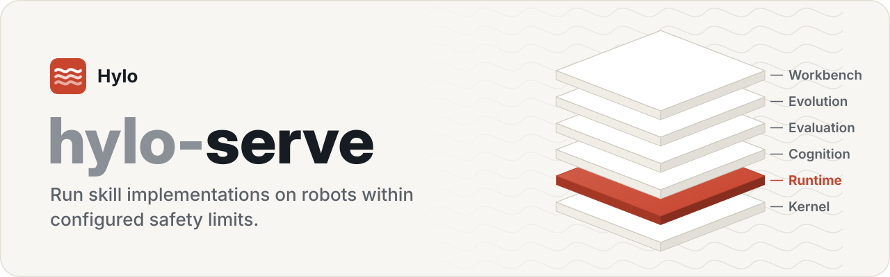
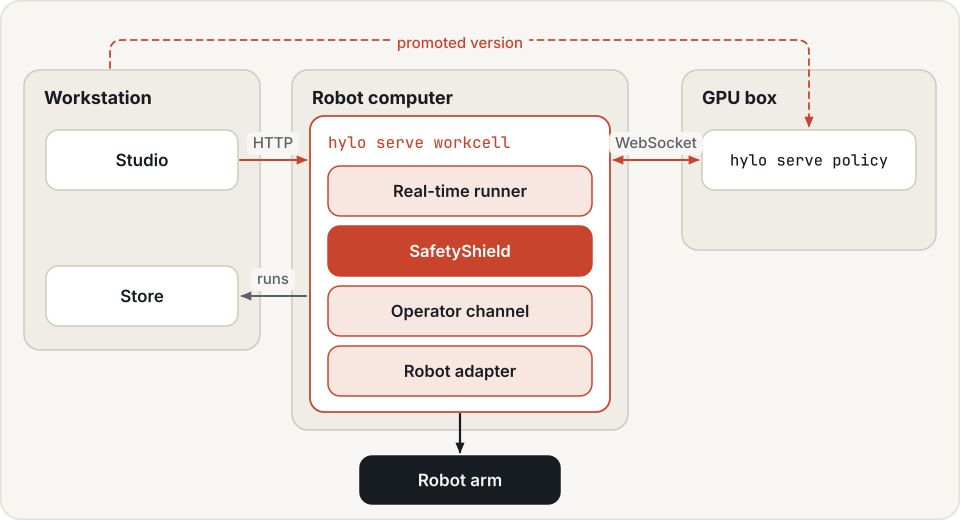
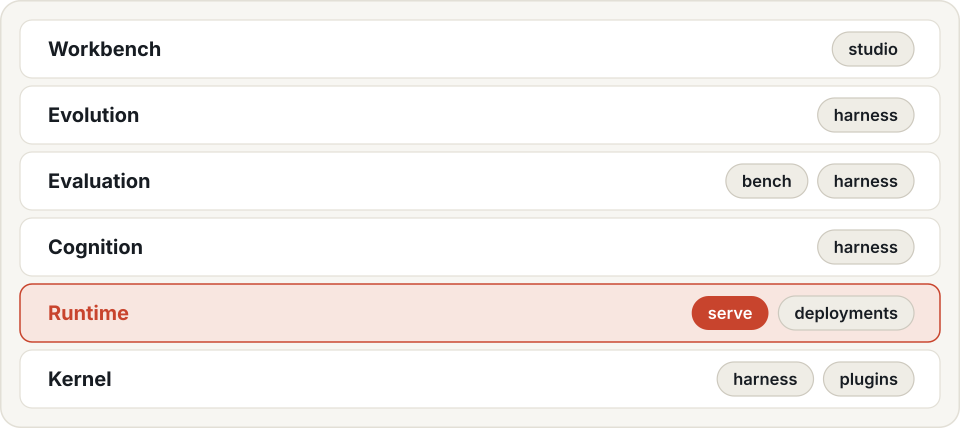

<p align="center">
  <picture>
    <source media="(prefers-color-scheme: dark)" srcset=".github/assets/banner-dark.svg">
    
  </picture>
</p>

<p align="center">
  <a href="LICENSE"></a>
  
  
  
</p>

<p align="center">
  <a href="https://hyloai.github.io/"><b>Website</b></a> ·
  <a href="https://hyloai.github.io/hylo-docs/"><b>Docs</b></a> ·
  <a href="https://hyloai.github.io/hylo-docs/getting-started/quickstart/"><b>Quickstart</b></a> ·
  <a href="https://github.com/HyloAI"><b>All repositories</b></a>
</p>

Part of [Hylo](https://hyloai.github.io/), the stack for physical AI. This repository is **Hylo Serve**, the
**runtime** layer.

Deployment: what runs next to a robot and on the GPU box that serves its policy. By default its packages depend on
`hylo-core` only, so a robot computer installs nothing else.

Serve runs selected implementations in the [robot-skill lifecycle](https://hyloai.github.io/hylo-docs/user-guide/skills/).
A campaign-following policy server
can serve an active agent version when its agent package, model assets and robot contract are available. Validate
those requirements before deploying a program strategy. The new manipulation programs have been measured in
simulation; their promotion does not establish physical-robot readiness. See
[strategy development](https://hyloai.github.io/hylo-docs/user-guide/developing-strategies/).

<p align="center">
  <picture>
    <source media="(prefers-color-scheme: dark)" srcset=".github/assets/topology-dark.svg">
    
  </picture>
</p>

| Package | Purpose |
|---|---|
| `packages/hylo-serve` | `hylo serve policy`: an agent behind the Hylo protocol (`/hylo`) and openpi's (`/openpi`), one session at a time, optionally following a campaign's `active.json`. `hylo serve workcell`: episodes on a robot or simulator with a remote policy, the SafetyShield, a real-time runner (aligned chunk merging, hold, watchdog) and an operator channel (e-stop latched until cleared, reset confirmation, verdicts), recorded as ordinary runs. `hylo serve env / agent`: one component over WebSocket. |
| `adapters/hylo-env-lerobot-robot` | real robots through LeRobot's `Robot` interface (SO-100/101, Koch, ...), a simulated arm, a bring-up wave policy |

```bash
uv run hylo serve policy --agent '{"type": "bringup.wave", "params": {"amplitude": 12, "horizon": 15}}' --port 8002
uv run hylo serve workcell --config ../deployments-template/workcells/sim_arm.yaml --port 8102   # from a deployments checkout: workcells/sim_arm.yaml
uv run hylo serve policy --campaign ../bench/runs/evolve/<campaign> --port 8001                   # serve a campaign's active version
```

Interfaces (defined in hylo-core, so callers never import this repository): the workcell API hylo.workcell/v0.1
(`core.remote.workcell`), the policy protocols (`core.remote`, `core.remote.wire`) and a campaign's active version
(`core.deployment`). Architecture and the real-robot path: hylo-docs, docs/design/architecture.md §3.8.

Documentation (hylo-docs, `uv run mkdocs serve -f docs/mkdocs.yml` from the workspace): [deployment](../docs/docs/user-guide/deployment.md), [safety](../docs/docs/user-guide/safety.md), [deployments repository](../docs/docs/configuration/deployments-repo.md).

## The Hylo stack

<p align="center">
  <picture>
    <source media="(prefers-color-scheme: dark)" srcset=".github/assets/stack-dark.svg">
    
  </picture>
</p>

## License

Apache License 2.0 (see [LICENSE](LICENSE)). Copyright 2026 Hylo AI.
